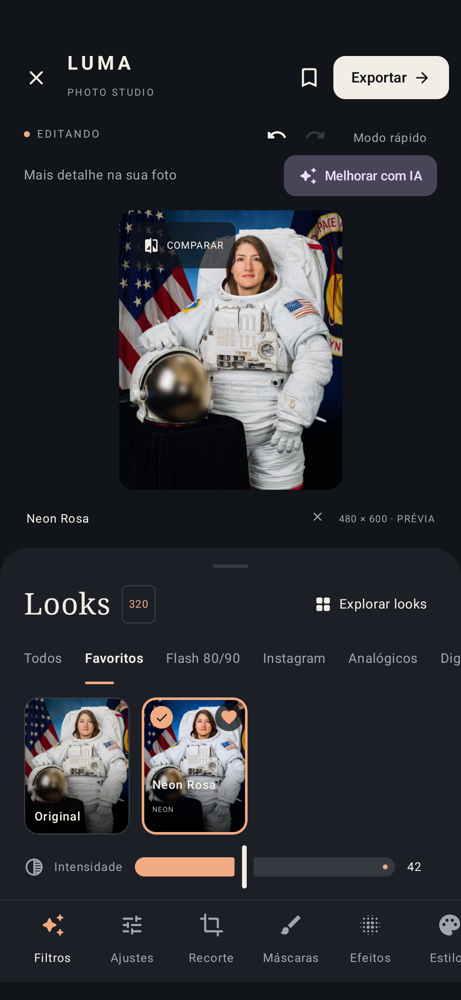
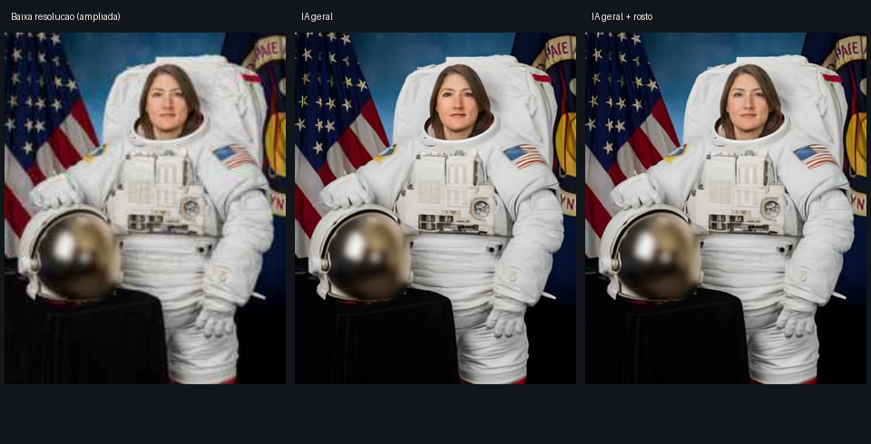

# Melhoria opcional de fotos — 1.5.0

No editor de foto, **Melhorar com IA** abre a conexão com o PC ou, depois de conectar, as opções de ampliação, força e restauração de rostos. O PC executa Real-ESRGAN x4plus e GFPGAN v1.4 na GPU NVIDIA. O editor Android prepara a imagem já editada em até 2048 px, envia um PNG sem EXIF/GPS e recebe um PNG de até 4096 px no maior lado.

O resultado aparece numa comparação deslizante. **Usar cópia melhorada** salva as edições do projeto anterior e cria um novo projeto com os pixels restaurados; **Manter como estava** remove somente o arquivo temporário. A imagem da galeria e a fonte privada do projeto anterior não são alteradas. A melhoria é incorporada à nova fonte; os controles começam sem tratamentos adicionais para evitar aplicar o mesmo filtro duas vezes. A cópia pode receber filtros, virar Story e ser exportada pelo fluxo existente.

Há uma inferência por vez no PC. Cancelar interrompe a espera no celular; uma tarefa já iniciada pode terminar no PC antes de liberar a GPU. Falhas do modelo produzem erro, sem substituição por simples nitidez ou pixels de outro tile. Os modelos ficam carregados, mas imagens e resultados não são persistidos no servidor. Configurações, pesos e logs técnicos ficam em `.tools/`, fora do Git.

O código de conexão de seis números é temporário e de uso único. A credencial permanente é cifrada com Android Keystore. O cliente recusa HTTP público, caminhos e credenciais no endereço, e não segue redirecionamentos. HTTP local deve ser usado numa rede confiável; o firewall configurado nesta instalação permite somente o IP do celular na porta do serviço. PC e celular precisam estar na mesma rede, e o PC precisa estar ligado com o serviço aberto.

## Referência visual

Editor capturado no Samsung durante os testes de regressão, com o retrato de teste NASA. O botão fica acessível acima da foto, sem alterar as ferramentas existentes.

Teste com o retrato público de Christina Koch, crédito NASA, reduzido e degradado para avaliar restauração. Colunas: entrada ampliada para comparação, Real-ESRGAN, Real-ESRGAN com GFPGAN. Nenhuma foto pessoal foi utilizada. A restauração pode criar detalhes e alterar traços; a comparação antes de salvar é parte do fluxo. Não se promete reconstrução fiel de informação ausente nem equivalência com a tecnologia proprietária do Remini.

Proveniência da imagem em [assets/README.md](../app/src/androidTest/assets/README.md). Instalação e operação em [server/README.md](../server/README.md); resultados da entrega em [VERIFICATION.md](VERIFICATION.md).
