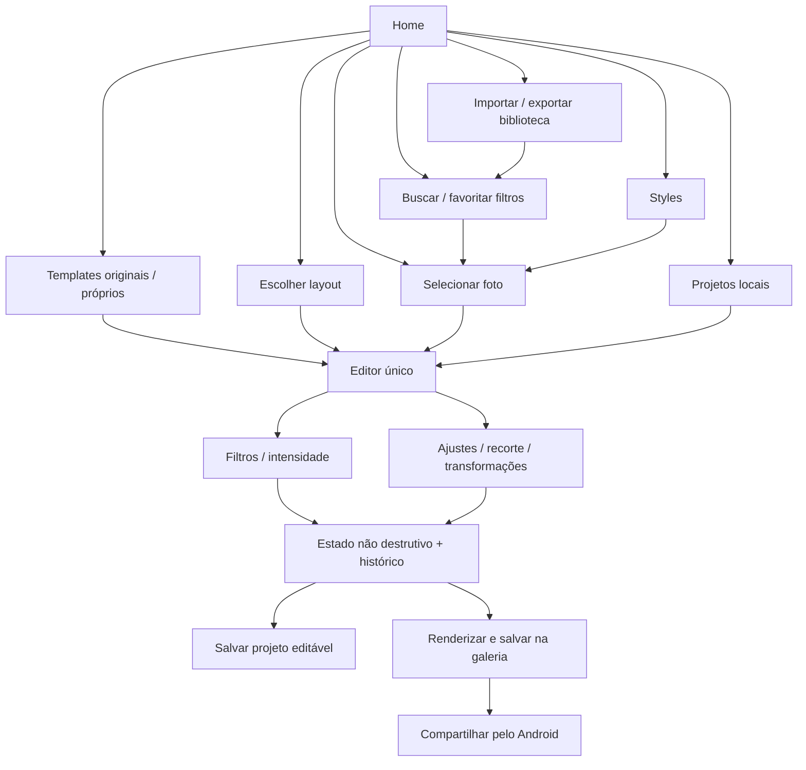

# Luma Studio — arquitetura e escopo

Aplicativo Android pessoal, offline, Kotlin/Compose. Nome provisório Luma Studio. Android 10+ (API 29), compile/target 36. Não há permissão INTERNET, login, publicidade ou upload; backup automático desabilitado. O seletor do sistema concede acesso apenas à foto escolhida.

## Análise do pedido

As prioridades são tratamento fotográfico real, edição não destrutiva, extensibilidade por dados e fluidez. As 41 seções do briefing se distribuem em cinco fases. A versão 1.1.0 reúne as fases 1–5 para fotos e Stories: ajustes avançados, referência local, recursos pessoais, máscaras, seleção automática e enquadramento. Vídeo, HDR/RAW/tiles e IA generativa opcional permanecem evoluções explícitas. Detalhes atuais em ADVANCED-EDITOR.md.

## Módulos e dependências

- `core`: Kotlin JVM puro. Modelos serializáveis, curvas, normalização, histórico de estados pequenos, validação. Portável sem Android.
- `renderer`: biblioteca Android. EGL/OpenGL ES 2.0 offscreen, shaders próprios, transformação/crop, decode sRGB orientado e compositor Android Canvas para fotos processadas/textos/formas. Preview e exportação usam os mesmos renderizadores.
- `app`: Compose Material 3, ViewModel, Photo Picker, catálogo JSON, arquivos locais e exportação via MediaStore.

Filter/effect/layer/template/project/asset/export engines são responsabilidades, não onze módulos vazios. Extraí-los quando houver implementação e necessidade reais. Não usamos editor de terceiro. Compose, lifecycle, coroutines e serialization justificam-se por UI, ciclo de vida e tarefas; ExifInterface por metadados opcionais. Room só quando índices relacionais forem necessários. ML Kit Selfie Segmentation e Face Detection são dependências locais incorporadas. Media3 fica para vídeo futuro.

## Dados e contratos

`Project` usa schema 8 e aceita projetos antigos com schema 1–7: id, nome, timestamps e EditState. `EditState` contém Transform, Adjustments, FilterSelection, lista ordenada de EffectLayer, LocalMask para fotos simples e StoryDocument opcional. `Transform`: crop normalizado [0..1], quartos de volta e flip X/Y. `FilterPreset`, `EffectPreset` e `StoryTemplate` usam schema 1. Filtros incorporam ajustes, curvas RGB/R/G/B, split tone e intensidade; efeitos incorporam a definição/parametrização do preset e intensidade/visibilidade por instância. StoryDocument contém tamanho, fundo e camadas ordenadas de fotos/textos/formas/stickers com posição, tamanho, ângulo, opacidade, blend, bloqueio e visibilidade. Fotos apontam para um asset privado imutável e mantêm zoom/pan e máscaras próprias. Typography contém parâmetros serializáveis; o compositor usa fontes do Android ou arquivos tipográficos privados importados. Template vira um StoryDocument editável, mantendo sua origem em templateId. StylePreset é executável: guarda cor, stack ordenada de efeitos e elementos gráficos proporcionais ao canvas de referência. Exemplos em `docs/formats/`.

Projeto desconhecido/incompatível é rejeitado, não silenciosamente mutilado. Fontes e thumbnails ficam fora dos snapshots do histórico. Um gesto de slider equivale a um comando de undo. Reabrir restaura o estado e até 20 estados de cada direção do histórico.

## Pipeline implementado

Fonte privada → decode sRGB com orientação EXIF → crop → flip/rotação → ajustes base → tratamento do filtro (curvas, balanço cromático, luminância, sombras/highlights, split tone) → mistura pela intensidade → vinheta → máscaras/ajustes locais em sequência → stack de efeitos GPU → bitmap sRGB → preview/arquivo.

GpuEffects reutiliza três targets sem ler/escrever a mesma textura no mesmo passe. Grain/dust/leaks/frames/chromatic usam shader procedural; blur é separável; bloom extrai luminância, desfoca em dois eixos e compõe com a fonte. Parâmetros espaciais usam referência normalizada de 1080 px. Seeds são determinísticos. Alpha premultiplicado evita halos em fotos PNG; blur interpola o alpha com o da fonte.

StoryRenderer compõe fundo → camadas visíveis de baixo para cima → transform/clip/opacidade/blend. Cada foto passa pelo mesmo GpuRenderer, com filtros/ajustes/efeitos do projeto, antes da composição. Texto usa StaticLayout/TextPaint e shapes usam Canvas. UI desenha apenas seleção/guias, ausentes da exportação. Templates e criação manual compartilham StoryDocument, histórico e renderizador. Preview limita o lado a 1280; cache de fotos processadas tem limite de 8 imagens/48 MB. Exportação recalcula na resolução solicitada, sem usar o preview. Fotos faltantes recebem indicação apenas no editor e bloqueiam exportação. Mutex impede reciclar fotos em uso enquanto outro render acessa o cache.

Preview e exportação usam o mesmo shader GLSL em uma thread de GPU dedicada com contexto EGL persistente. Preview limita o maior lado a 1280 px; miniaturas a 224 px em um segundo contexto EGL/thread, cache de 60 imagens, duas tarefas simultâneas e geração lazy. Arrastar controles nunca decodifica a fonte original. Exportação decodifica novamente na resolução necessária e roda fora da UI. A intensidade interpola entre resultado dos ajustes base e resultado do filtro: intensidade zero não elimina os ajustes pessoais.

Curvas, HSL seletivo, LUT 3D e ajustes de vizinhança estão disponíveis no mesmo renderer. A imagem usa SDR sRGB 8 bits; exposição é calculada em luz linear e reconvertida para sRGB, enquanto curvas e ajustes tonais usam sRGB. HDR/wide gamut e pipeline inteiramente linear são evolução explícita. Não reivindicamos precisão de color grading profissional já pronta.

Exportação original preserva dimensões após crop/rotação, não metadados por padrão. JPEG/PNG/WebP, qualidade e lado máximo/custom são suportados. EXIF opcional copia apenas câmera/data/exposição; localização GPS nunca é copiada automaticamente. Imagens maiores que a capacidade GPU ou o orçamento de memória exibem erro; nunca são reduzidas silenciosamente. Renderização em tiles é pendente.

## Armazenamento

`files/projects/<uuid>/source` (foto original imutável), `photo_<uuid>` (originais de camadas Story), `project.json` (estado versionado, escrita atômica), `thumbnail.jpg`. Story em branco não exige source. `files/library/favorites.json` guarda favoritos dos catálogos; catalog.json armazena o catálogo pessoal por AtomicFile. Catálogos em `assets/filters`, `assets/effects`, `assets/templates`. Assets privados permanecem para undo e reabertura; limpeza de fontes sem referências é evolução futura. Packs usam manifesto versionado, arquivos referenciados permitidos, limites, proteção contra traversal/expansão, staging e commit atômico. Fontes/LUTs/imagens e referências aninhadas são remapeados; remoção coleta apenas recursos globais sem referências.

## Navegação

Home → Photo Editor, filtros, Story Maker em branco ou Templates. Templates → busca/favoritos/preview → projeto editável → preencher fotos → personalizar → salvar/exportar. Projetos reabre fotos e Stories. Quick/Pro são níveis de acesso aos mesmos parâmetros, nunca cópias achatadas do projeto. Voltar exige salvar/descartar alterações reais. Colagens e Style Lab usam os mesmos projetos. Máscaras abrem um espaço de edição da foto selecionada, sem criar outro projeto.

## Fases seguintes

Fase 4 concluída no escopo incremental: criador de templates, colagens, Style Lab e packs próprios validados.
5. Máscaras disponíveis em 0.5.0 e seleção local de pessoa/fundo com recorte transparente em 0.6.0. Smart crop/atribuição de fotos às molduras disponíveis em 0.7.0; referência estética estatística disponível em 1.0.0; IA generativa opcional permanece futura. Detalhes do modelo/persistência em SEGMENTATION.md.

## Fontes técnicas consultadas

- https://developer.android.com/build/releases/agp-8-10-0-release-notes
- https://developer.android.com/develop/ui/views/graphics/opengl/about-opengl
- https://developer.android.com/training/data-storage/shared/photo-picker
- https://developer.android.com/develop/ui/compose/bom/bom-mapping
- https://kotlinlang.org/docs/compose-compiler-migration-guide.html

## Biblioteca e colagens (0.4.0)

CollageEngine fica no core, com layouts determinísticos e parâmetros serializáveis no StoryDocument. Reflow preserva IDs/assets/crops/pan/zoom/textos e respeita fotos bloqueadas. O compositor aplica LayerAppearance por foto: bordas, cantos arredondados e sombra. A sombra usa bounds ampliados do grupo; clipping arredondado limita somente o conteúdo da foto. PhotoTransform preserva crop/rotação/flip inclusive ao converter uma foto simples para composição com gráficos.

Template próprio mantém o look completo e permite fotos fixas ou preenchíveis. Fotos fixas são copiadas da fonte privada do projeto para library/assets/photo_UUID; cada projeto criado pelo template recebe uma cópia privada dessas fontes. Textos não editáveis inicialmente ficam bloqueados. Originais nunca são substituídos por imagens processadas.

StylePreset guarda FilterSelection, Adjustments, EffectLayers (instâncias com intensidade/visibilidade) e elementos sem fotos, com width/height de referência. Aplicar substitui a cor/efeitos e os elementos de estilos anteriores identificados por styleElement, preservando gráficos manuais. Se houver gráficos numa foto simples, a fonte é copiada para uma camada com PhotoTransform; UI muda para a composição compartilhada. Não há outro renderer de Style Lab.

Filtros pessoais preservam savedAdjustments e savedIntensity junto com os mesmos parâmetros/curvas do filtro original. A seleção recompõe esses ajustes base e a intensidade; o shader continua usando os operadores existentes, sem aproximação por soma de ajustes não lineares.

LibrarySnapshot guarda filtros/efeitos/templates/estilos pessoais e InstalledPack. Catálogos embutidos são combinados com o snapshot e atualizados no ViewModel após salvar/importar. PackCodec no core valida ZIP próprio, schema, parâmetros, nomes/duplicatas/referências e limites de entrada/expansão; StudioStore valida imagens em staging e copia com novos UUIDs antes do commit único do catálogo. Falha desfaz somente arquivos novos. Conteúdo e IDs incorporados aos projetos tornam sua reabertura independente da biblioteca. Mais detalhes em PACKS.md.

## Enquadramento (0.7.0)

FocusAnalyzer produz metadados transitórios a partir dos modelos incorporados. SmartFraming no core calcula crop seguro e atribuição global de fotos às molduras. SmartProposal contém o edit candidato e uma prévia, mantendo o histórico atual intacto até aplicar. Cancelar apenas descarta a proposta. photoFit=contain usa escala mínima e cover usa escala máxima no StoryRenderer, no decode e na composição, com o mesmo caminho para preview/export. Projetos salvos sobem para schema 7; versões anteriores adotam cover. Mais detalhes em SMART-FRAMING.md.

## Atualização completa

ColorTreatment manual e por preset, efeitos locais, fontes privadas, desenhos, gradientes e históricos serializados compartilham renderer/persistência. Recursos e referências são coletados recursivamente, copiados nos projetos e remapeados na importação. Exportação em lote processa sequencialmente e permite parar após a foto atual. Consulte ADVANCED-EDITOR.md para operadores e limites exatos.
