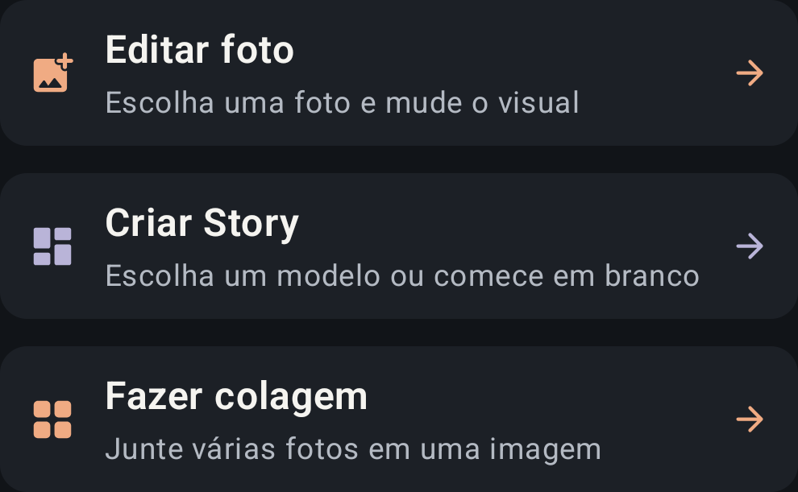
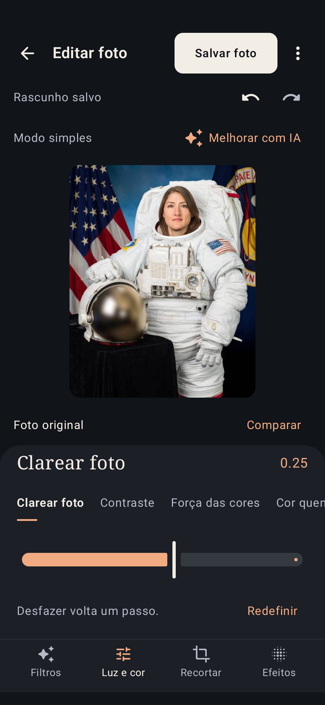
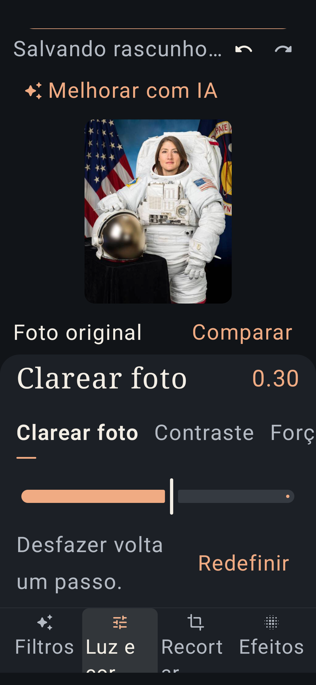
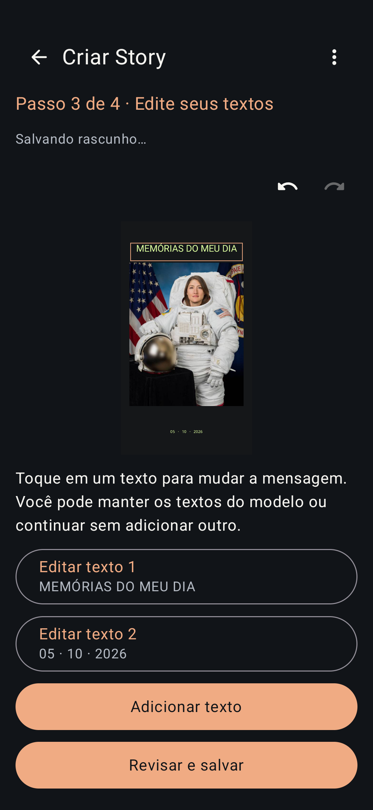
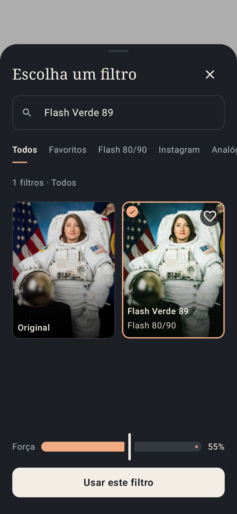
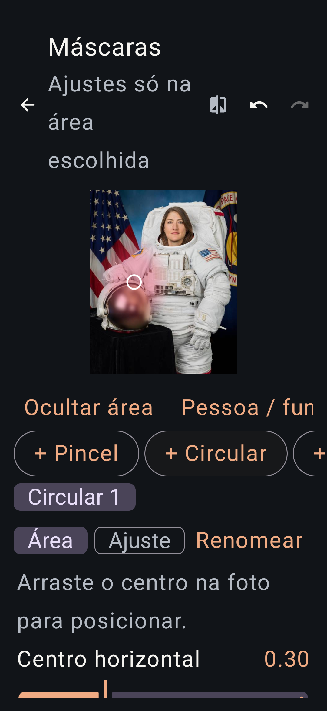

# Uso e acesso às ferramentas — 1.7.0

O início organiza o app pelas tarefas: Editar foto, Criar Story e Fazer colagem. Projetos recentes vêm em seguida. Estilos prontos, edição em lote e recursos próprios continuam abaixo. Os cards têm menos altura e espaço interno, títulos de 17 sp e ícones de 22 dp. A barra de ferramentas de foto usa ícones de 22 dp e rótulos de 12 sp. O tamanho padrão é compacto; a letra acompanha a escala escolhida no Android.

Criar Story abre a mesma biblioteca da aba Stories, com modelos e uma opção em branco. O projeto abre no editor completo. **Passo a passo** é uma opção do usuário; não há assistente obrigatório.

## Story com passo a passo opcional

1. Escolha um modelo ou um Story em branco. Abra **Passo a passo** no editor se quiser orientação por tarefa.
2. Adicione as fotos do modelo. Cada foto possui troca e ajuste de enquadramento; a próxima etapa fica indisponível enquanto houver foto visível faltando. Um Story em branco pode continuar somente com texto.
3. Toque em cada texto para mudar a mensagem. A edição inicial mostra mensagem, tamanho e cor; **Mais opções de texto** abre as configurações tipográficas detalhadas.
4. Confira e salve na galeria. A resolução usa o mesmo diálogo das fotos, incluindo 1440p/4K. Compartilhar fica disponível após salvar.

Voltar às fotos ou textos conserva as alterações; undo/redo e rascunhos usam o mecanismo existente. **Todas as ferramentas** retorna à edição completa no mesmo projeto. Os botões de posição em **Ajustar camada** permitem mover sem arrastar. A etapa do assistente não é persistida no rascunho; o conteúdo editável é recuperado ao reabrir.

## Conexão com a IA por QR

No PC, abrir **Ver conexão Luma IA.cmd** mostra QR, endereço e código temporário por até dez minutos. No app, abrir **Melhorar com IA → Ler QR do PC**, ler o QR e conferir o endereço antes de **Conectar PC**. Ler ou revisar o QR não envia fotos. O app verifica novamente o vencimento na confirmação.

Depois da conexão, o status distingue pronto, carregando, ocupado e indisponível. **Verificar PC novamente** atualiza a disponibilidade; o início da melhoria exige uma resposta pronta. O PC precisa continuar ligado e alcançável. A entrada manual continua disponível, inclusive se o leitor do Google Play Services precisar de download inicial ou não estiver disponível. Detalhes em [server/README.md](../server/README.md).

## Editar uma foto

1. Toque em Editar foto e escolha a imagem no seletor do Android.
2. Toque numa miniatura de filtro. Original remove o filtro; Força ajusta sua intensidade. Ver todos abre busca, favoritos e as coleções completas.
3. Luz e cor oferece Clarear foto, Contraste, Força das cores, Cor quente ou fria e Áreas escuras. Recortar e Efeitos ficam ao lado. Desfazer/refazer preservam os passos da edição.
4. Toque em Salvar foto e depois Salvar na galeria. O arquivo vai para a pasta Luma Studio da galeria, com opção de compartilhamento.

O modo simples usa um carrossel menor, com favoritos, Flash 80/90, Instagram, retratos e o filtro atual. Não remove filtros do catálogo. Mais ferramentas abre máscaras, estilos, cor avançada, ajuda e todas as ferramentas; Usar modo simples retorna aos quatro controles principais.

## Salvar foto e salvar projeto

Salvar foto gera uma imagem na galeria. O padrão é JPEG, qualidade 95, resolução Original e sem metadados opcionais. Original considera a transformação da foto ou o canvas do Story; não significa desfazer a edição. 1440p e 4K usam, respectivamente, 2560 e 3840 pixels no maior lado. Ampliar pixels sozinho não recupera detalhes ausentes.

Opções avançadas mostra formatos JPEG/PNG/WebP, qualidade, dimensões de publicação ou personalizadas e metadados de câmera/data para JPEG. O cálculo de resolução e os limites do renderer permanecem iguais à correção da versão 1.4.1. A opção personalizada determina dimensões exatas.

Salvar projeto editável, em Mais ferramentas, confirma nome, edição, histórico e thumbnail no projeto privado. O rascunho automático é separado desse salvamento. Um arquivo na galeria e um projeto editável são dois resultados distintos, identificados pelos rótulos das ações.

## Rascunhos automáticos

- Cada projeto possui um draft.json privado na própria pasta. A gravação usa AtomicFile e um mutex compartilhado entre instâncias do armazenamento; o original e o project.json não são alterados pela gravação do rascunho.
- Alterações reiniciam uma espera de 900 ms. O app tenta gravar imediatamente ao entrar em segundo plano, quando a edição não está ocupada. Voltar ao início aguarda a gravação antes de fechar a edição; uma falha mantém a edição aberta e informa o erro.
- Projeto salvo, Salvando rascunho…, Rascunho salvo e Rascunho não salvo indicam o estado. Espere Rascunho salvo antes de encerrar abruptamente o app; não existe garantia de persistência antes dessa confirmação.
- Reabrir recupera a edição e até 20 estados persistidos de cada direção do histórico. Uma alteração de slider ainda não concluída é incluída no histórico da recuperação sem modificar o undo da sessão atual.
- O rascunho referencia o timestamp do último salvamento explícito. Versão base diferente, ID diferente ou conteúdo inválido descartam o rascunho, preservando o projeto salvo. A gravação atrasada não pode recriar um projeto excluído.
- Salvar projeto editável confirma a edição e limpa o rascunho. Descartar rascunho exige confirmação e retorna ao último projeto salvo, sem apagar a fonte ou exportações da galeria.
- Fotos e Stories usam o mesmo mecanismo. Projetos recentes consideram a última gravação de rascunho na ordenação; o thumbnail continua representando o último salvamento explícito, enquanto as alterações são recuperadas ao abrir.

## Leitura e interação

Os textos funcionais acompanham a configuração do Android. Botões, categorias e ações essenciais conservam espaço para toque sem ampliar seus ícones; a aparência padrão usa menos altura e espaço interno. Sliders recebem descrições do ajuste e o estado do rascunho usa anúncio sem interromper a navegação. O modo simples mostra quatro ferramentas sem exigir rolagem horizontal da barra.

Fonte a partir de 130% ou janela abaixo de 640 dp ativa rolagem vertical nos editores de foto, Story e máscaras; no editor de foto, salvar ganha uma linha própria. Filtros e modelos acomodam letras ampliadas em grades com mais largura. O teste de 200% usa uma substituição de densidade dentro do app QA: não altera a preferência de fonte do celular. Ações avançadas oferecem movimento de camada por botões, coordenadas de máscaras e ajuste de bordas do recorte por sliders. Pincel e desenho livre continuam visuais.

**Facilidade de uso → Reduzir movimento** conserva uma preferência local e torna mudanças de filtro imediatas, com indicadores estáticos durante espera. Animações desativadas no Android também ativam esse comportamento.

Ajuda curta está no início e em Mais ferramentas; explica foto, filtro, ajustes, galeria, rascunhos, Stories e IA. Não há tutorial obrigatório.

## Limites da avaliação

O assistente opcional, QR, disponibilidade do PC, alternativas aos gestos e movimento reduzido estão implementados. As verificações realizadas e seus limites estão em [VERIFICATION.md](VERIFICATION.md). Falta observar usuários iniciantes e pessoas com diferentes necessidades concluindo tarefas sem ajuda; o [protocolo](USABILITY-USER-TEST.md) está preparado, sem resultados inventados. Não é possível garantir facilidade a partir de um diagnóstico.

A recuperação foi testada com um novo ViewModel lendo o rascunho do disco e com fechamento/reabertura da edição. Não foi testado o encerramento forçado do processo durante uma gravação. Os modelos de IA não foram alterados; a conexão completa do pacote pessoal ao PC continua não confirmada. Limitações anteriores estão em [VERIFICATION-1.5.0.md](VERIFICATION-1.5.0.md).

## Capturas do aparelho

O retrato é uma fixture pública NASA, usada somente na instrumentação; crédito e origem em app/src/androidTest/assets/README.md. As capturas não incluem fotos pessoais e a fixture não entra no APK release.
